# SwadharmaPath — Business Requirements Document (BRD)

| Field | Value |
|---|---|
| Document | BRD |
| Version | 1.1 |
| Status | Baseline for V1 (launch) |
| Last updated | 2026-10-24 |
| Source | SwadharmaPath PRD (Sections 1, 3, 6, 8–13, 15, 17) as translated into the build prompt |
| Related | [HLD](../design/HLD.md) · [LLD](../design/LLD.md) · [User guides](../user-guides/) · [SOPs](../sops/) |

> Keep this document current. Any change to scope, rules, roles, consent, reports or disclaimers must update this BRD in the same pull request (see [CONTRIBUTING](../../CONTRIBUTING.md)).

---

## 1. Purpose

SwadharmaPath is a career-counselling platform for an Indian career-guidance agency. It takes a candidate from first enquiry to a tracked, dated career roadmap:

**lead → onboarding → psychometric battery → counsellor sessions → ranked options → education pathways and future-of-work outlook → dated roadmap → follow-up and outcomes.**

This BRD states what the business needs from the platform, who uses it, the rules it must follow and how success is measured. How it is built is in the [HLD](../design/HLD.md) and [LLD](../design/LLD.md).

## 2. Business context and problem

- Counselling today is run on spreadsheets, WhatsApp and ad-hoc PDFs. Leads are lost, follow-ups are missed, and report turnaround is not measured.
- Families need a clear, evidence-based recommendation that is explained in plain language, not a single "type" or a single career.
- Class 8–10 students need a **stream** decision (which subjects in Class 11–12), not a career decision.
- The agency offers a distinctive **Swadharma** (Vedic astrology) lens. It must be handled ethically: consented, counsellor-controlled, never used to rule out a career, and never shown to a family without a deliberate, logged release.

## 3. Objectives

| # | Objective | Measure |
|---|---|---|
| O1 | No lead is lost | 100 % of leads have a stage, an owner and a next follow-up date |
| O2 | Faster, predictable reports | Candidate-facing report within 7 days of the last completed assessment (report SLA) |
| O3 | Trustworthy recommendations | Ranked options with an explanation per dimension; counsellor approves before any candidate sees results |
| O4 | Track the outcome, not only the session | Outcome checkpoints at 6, 12 and 24 months; % of candidates in a top-5 option |
| O5 | Ethical handling of Swadharma and minors | Zero Swadharma data visible to a family without a logged release; zero assessments by a minor without guardian consent |
| O6 | Visible business health | Admin dashboard: funnel, revenue (manual paid flag), utilisation, turnaround, NPS, outcomes |

## 4. Scope

### 4.1 In scope (V1 / P1 — must have at launch)

1. Lead form and lead pipeline with counsellor assignment and follow-up reminders.
2. Track-aware onboarding, including guardian consent for under-18s and optional Swadharma opt-in with versioned consent text.
3. Test runner with autosave, timers and resume; six instruments, with junior variants for `early_explorer`.
4. Scoring → results → profile, with counsellor approval before the candidate sees the profile.
5. Career matching (student, professional) and stream recommendation (early_explorer), with counsellor curation and a publish gate.
6. Career library with education pathways and outlook; stream options by board. Admin refreshes the library quarterly (AI-drafted changes or an edited CSV), approving each change before it applies.
7. Counsellor workspace with the Swadharma 🔒 tab and the Release flow.
8. Sessions with ICCC-stage templates and candidate-visible summaries.
9. Roadmaps from templates; candidate task updates; nudges for missed items.
10. Six report kinds as branded PDFs generated by the worker, downloaded through short-lived signed URLs.
11. Parent portal; counsellor and admin dashboards.
12. Disclaimer acknowledgement at onboarding and on every report.
13. Admin archiving of inactive candidates and leads, with an admin-set inactivity timeframe, optional nightly auto-archive and restore.

### 4.2 Out of scope for V1

- Online payments (V1 uses a manual "paid" flag on the lead stage).
- Native mobile apps (the web app must work on mobile browsers).
- Automated WhatsApp/SMS campaigns (notification rows are created; delivery channels are a later phase).
- Languages other than English in the UI (the `language_pref` field exists for later).

## 5. Stakeholders and users

| Role | Who | Primary goals | Home |
|---|---|---|---|
| Candidate | Student (Class 8 to PG) or working professional | Take assessments, understand themselves, see options and a plan | `/me` |
| Parent / guardian | Linked to a candidate | Give consent for minors, follow progress, read the parent summary | `/family` |
| Counsellor | Agency staff | Run cases end to end: assess, interpret, curate, plan, report | `/cases` |
| Admin | Agency owner / operations | Pipeline, staffing, library, instruments, templates, business metrics | `/admin` |
| Agency owner (sponsor) | Business | Growth, quality, reputation, compliance | Admin dashboard |

## 6. Candidate tracks

| Track | Who | Decision supported | Journey labels on `/me` |
|---|---|---|---|
| `early_explorer` | Class 8–10 | Stream choice for Class 11–12 | Onboard → Discover → Talk → Streams → Explore Plan |
| `student` | Class 11–12 and UG | Career choice | Onboard → Assess → Sessions → Options → Roadmap |
| `professional` | Working adults | Career transition | Onboard → Assess → Sessions → Options → Roadmap |

The `early_explorer` experience uses larger type, illustrations, friendlier copy, junior instrument variants, a "leanings not types" tone in reports, and **never recommends a single career**.

## 7. Business process (end to end)

```mermaid
flowchart LR
  A[Enquiry /enquire] --> B[Lead pipeline<br/>new → contacted → discovery → paid]
  B --> C[Candidate account + onboarding<br/>disclaimer, guardian consent, optional Swadharma consent]
  C --> D[Psychometric battery<br/>test runner]
  D --> E[Scoring worker<br/>results + validity flags]
  E --> F[Counsellor review<br/>approve profile]
  F --> G[Matching<br/>careers or streams]
  G --> H[Counsellor curation<br/>pin / hide / add → publish]
  H --> I[Sessions<br/>ICCC stages]
  I --> J[Roadmap<br/>template → publish]
  J --> K[Reports<br/>PDF via worker]
  K --> L[Follow-up<br/>nudges, outcomes 6/12/24 m]
```

ICCC counselling stages used on cases and sessions: `know_self → know_world → decide → plan → act → review`.

## 8. Functional requirements

IDs are stable; reference them in pull requests and tests.

### 8.1 Leads (FR-L)

| ID | Requirement | Priority |
|---|---|---|
| FR-L1 | Public enquiry form collects name, phone, email, track, class/role, city, how-did-you-hear; anyone can submit without logging in. | P1 |
| FR-L2 | Enquiries are rate-limited to stop spam and abuse. | P1 |
| FR-L3 | Lead sources: web, whatsapp, referral, school, walk_in. Stages: new, contacted, discovery, paid, active, completed, lost. | P1 |
| FR-L4 | Admin sees a pipeline board, assigns a counsellor and sets a next follow-up date. | P1 |
| FR-L5 | A lead converts to a candidate; the link is kept for funnel reporting. | P1 |

### 8.2 Onboarding and consent (FR-O)

| ID | Requirement | Priority |
|---|---|---|
| FR-O1 | Candidate completes profile, academics and constraints; early_explorer also fills a subject-enjoyment grid (1–5 per subject, marks, teacher feedback). | P1 |
| FR-O2 | Candidate acknowledges the disclaimer (Section 12) with a timestamp before proceeding. | P1 |
| FR-O3 | Under-18 candidates cannot start any assessment until a linked guardian has given consent. An unknown date of birth is treated as under 18. | P1 |
| FR-O4 | Birth details are optional. They are collected only with an explicit consent checkbox whose text version is stored with the consent time and the person who consented. | P1 |
| FR-O5 | Candidates and parents can submit birth details but can never read them back. | P1 |

### 8.3 Assessments (FR-A)

| ID | Requirement | Priority |
|---|---|---|
| FR-A1 | Instruments: interest, aptitude, work-style, Big Five (standard only), values (school-values for junior), learning, subject enjoyment; each has a junior and/or standard variant and a version. | P1 |
| FR-A2 | Test runner shows one item per screen with a progress bar and estimated time. | P1 |
| FR-A3 | Answers autosave at least every 30 seconds; a candidate can close the browser and resume. | P1 |
| FR-A4 | Timed sub-tests show a timer; once a timed section starts its clock cannot be restarted and earlier items cannot be revisited. | P1 |
| FR-A5 | Test content (items, scoring keys, norms) is never shipped to the browser in bulk; items are served one at a time. | P1 |
| FR-A6 | Completing an assessment triggers scoring automatically. | P1 |
| FR-A7 | Counsellor can see validity flags and re-administer an instrument. | P1 |

### 8.4 Results and profile (FR-P)

| ID | Requirement | Priority |
|---|---|---|
| FR-P1 | Results include RIASEC code, aptitude bands, work-style graphs and pattern flags, Big Five percentiles, top values. | P1 |
| FR-P2 | Counsellor edits a plain-language narrative (strengths, watch-outs, themes) and approves the profile. | P1 |
| FR-P3 | Candidate and parent see results and profile only after counsellor approval. | P1 |

### 8.5 Options (FR-M)

| ID | Requirement | Priority |
|---|---|---|
| FR-M1 | Student/professional: top 15 careers ranked by fit score, each with a "why" per dimension, pathways and outlook to 2035. | P1 |
| FR-M2 | Early explorer: ranked streams with keeps-open and closes lists and three sample careers per open family; always include the widest "keep options open" combination; never a single career. | P1 |
| FR-M3 | Counsellor can pin, hide or add options and must publish before the candidate sees them. | P1 |
| FR-M4 | Swadharma points never appear in any candidate- or parent-visible option. | P1 |

### 8.6 Career library (FR-C)

| ID | Requirement | Priority |
|---|---|---|
| FR-C1 | Each career has family, RIASEC code, description, day in the life, entry paths, India salary band, outlook (growing / stable / transforming / declining), automation exposure, adjacent emerging roles, sources and last-reviewed date. | P1 |
| FR-C2 | Education pathways per career by level (Class 11–12, UG, PG, diploma, certification, global) with exams, degrees, institutions by tier, duration and alternative routes. | P1 |
| FR-C3 | Stream options are maintained per board (CBSE seeded first). | P1 |
| FR-C4 | Admin is reminded quarterly to refresh outlook, with source and last-reviewed date recorded. | P1 |
| FR-C5 | Admin can refresh careers, streams or both with one click (**Refresh now**). The system checks every entry against current Indian sources and drafts changes with citations; it also queues this refresh itself on 1 January, April, July and October. | P1 |
| FR-C6 | Admin can download the careers or streams library as CSV, correct it in a spreadsheet and upload it. Empty cells leave a field unchanged; a row without an id adds a new entry; invalid rows are listed and skipped. | P1 |
| FR-C7 | No refresh changes the library until an admin approves each change. Applying records the sources, stamps every entry in scope as reviewed today, and recalculates candidates' matches while keeping counsellors' pinned, hidden, added and published choices. | P1 |
| FR-C8 | Only one refresh can be open at a time; an admin can cancel an open refresh. Every request, cancellation and apply is audited. | P1 |

### 8.7 Swadharma layer (FR-S)

| ID | Requirement | Priority |
|---|---|---|
| FR-S1 | Computed only when the candidate has opted in and a consent timestamp exists. | P1 |
| FR-S2 | Produces points (max 100) for 15 career families, with component breakdown, confidence, favourable windows, a personality lens and an agreement matrix against the psychometric top 5. | P1 |
| FR-S3 | Visible only to the assigned counsellor and admins, enforced in the database. | P1 |
| FR-S4 | A counsellor may release a separate Swadharma Report to candidate, parent or both, with a mandatory reason. A release is logged and cannot be undone. | P1 |
| FR-S5 | Never states anything about health, marriage, longevity or wealth; never prohibits a career; for early_explorer, no career-specific statements. | P1 |
| FR-S6 | If birth time is unknown, only Moon-sign and dignity components run and confidence is "low". | P1 |

### 8.8 Sessions (FR-SE)

| ID | Requirement | Priority |
|---|---|---|
| FR-SE1 | Counsellor schedules sessions (video, in person, phone) with a meeting URL. | P1 |
| FR-SE2 | Session notes use ICCC-stage templates; private notes are never visible to the family; a separate candidate summary and action items are. | P1 |
| FR-SE3 | Counsellor schedule calendar at `/schedule`. | P1 |

### 8.9 Roadmaps (FR-R)

| ID | Requirement | Priority |
|---|---|---|
| FR-R1 | Templates: class8_10_exposure, class11_12, ug, pg_prep, transition, custom. | P1 |
| FR-R2 | Item kinds: milestone, task, exam, skill, checkin; owners: candidate, counsellor, parent. | P1 |
| FR-R3 | Candidate updates status and uploads evidence on their own items only. | P1 |
| FR-R4 | Overdue items are marked missed nightly and owners are nudged. | P1 |

### 8.10 Reports (FR-RP)

| ID | Requirement | Priority |
|---|---|---|
| FR-RP1 | Six kinds: candidate, candidate_junior (visual, ~8 pages, written to the student), parent (2 pages), stream_choice, case_file (everything incl. Swadharma, counsellor only), swadharma (separate, disclaimer on page 1). | P1 |
| FR-RP2 | Reports are branded PDFs, versioned, and never edited in place (a change creates a new version). | P1 |
| FR-RP3 | Stored privately; downloaded through signed URLs valid for 15 minutes. | P1 |
| FR-RP4 | Every report carries the disclaimer. | P1 |
| FR-RP5 | `/reports/queue` shows pending generations and SLA. | P1 |

### 8.11 Parent portal (FR-F) and dashboards (FR-D)

| ID | Requirement | Priority |
|---|---|---|
| FR-F1 | Parent sees linked children, progress %, next session, parent summary, read-only roadmap, and can message the counsellor. | P1 |
| FR-D1 | Counsellor caseload: name, track, ICCC stage, risk flag, next action, report SLA. | P1 |
| FR-D2 | Admin dashboard: funnel by lead stage, revenue (manual paid flag), counsellor utilisation, report turnaround, NPS, outcomes. | P1 |
| FR-D3 | Admin editors: careers, streams, instruments (versions, norms upload, activate), roadmap and session-note templates. | P1 |
| FR-D4 | Admin can archive candidates and leads with no activity before a chosen date, after previewing who would move, and restore any archived row. | P1 |
| FR-D5 | Admin sets the inactivity timeframe (in months, separately for candidates and leads) and can turn on nightly auto-archive using it. Auto-archive is off by default. | P1 |

### 8.12 Follow-up (FR-FU)

| ID | Requirement | Priority |
|---|---|---|
| FR-FU1 | Outcome checkpoints at 6, 12 and 24 months record status, career, whether it was in the top 5, and satisfaction 1–5. | P1 |
| FR-FU2 | Nightly reminders for checkpoints and report SLA breaches. | P1 |

## 9. Business rules

| ID | Rule |
|---|---|
| BR-1 | A candidate never sees psychometric results or profile until a counsellor approves the profile. |
| BR-2 | A candidate never sees options until a counsellor publishes them; hidden options never show. |
| BR-3 | Swadharma data is counsellor/admin-only. The only path to a family is a Swadharma Report released with a reason; the release is permanent and audited. |
| BR-4 | Psychometrics drive the recommendation; Swadharma is a reflection lens only and is never used to rule out a career. |
| BR-5 | Early explorers get stream recommendations that keep options open; never a single career. |
| BR-6 | Under-18 candidates (or unknown DOB) need guardian consent before any assessment. |
| BR-7 | Reports are immutable; a correction is a new version. Case files and Swadharma reports start counsellor-only. |
| BR-8 | Releases and the audit log are append-only for every role, including administrators through the API. |
| BR-9 | Counsellor and admin roles are granted by an admin only; self-signup can only create candidate or parent accounts. |
| BR-10 | Report SLA: a candidate-facing report is due 7 days after the last completed assessment. |
| BR-11 | Library changes from AI or CSV are proposals only; an admin approves each one before it is written. |
| BR-12 | Archiving never deletes data. Reports, the audit log, releases, consent and Swadharma records stay as they are; archived cases leave caseloads, reminders and matching, cannot start assessments, and can be restored by an admin. |
| BR-13 | A candidate with a session booked, and a lead that is paid or active, is never archived. The cutoff is at least 30 days ago. |

## 10. Non-functional requirements

| Area | Requirement |
|---|---|
| Security | Row-level security on every table; visibility rules enforced in the database, not only in the UI. Secrets live only in the worker and Edge Function environments. |
| Privacy | Indian DPDP Act 2023 principles: purpose limitation, explicit and versioned consent, guardian consent for minors, data minimisation, access only on need. |
| Availability | Business-hours availability target 99.5 %; scoring and report generation may be asynchronous. |
| Performance | Next item in the test runner in under 1 s on a 4G connection; dashboards in under 3 s. |
| Accessibility | Large readable type, high contrast, keyboard navigable, mobile-first layouts. |
| Auditability | Consent, disclaimer acceptance, Swadharma release and role changes are recorded with actor and time. |
| Maintainability | Every code or spec change updates the docs in the same pull request (enforced by CI). |

## 11. Assumptions, constraints and dependencies

- Hosting: Vercel (web), Supabase (database, auth, storage, Edge Functions), Railway (Python worker).
- Instrument items in the seed data are placeholders. Licensed or original validated items and norms must be loaded before launch.
- Career library and outlook seed content is marked "seed – verify before launch" and must be reviewed by the agency.
- Revenue is a manual flag in V1.

## 12. Disclaimer (verbatim; must appear at onboarding, on every report, and on page 1 of the Swadharma Report)

> "SwadharmaPath supports career decisions; it does not make them. Psychometric results describe tendencies at a point in time and are interpreted by a trained counsellor; they are not a measure of worth or a guarantee of success. The Swadharma (Vedic astrology) analysis is a traditional lens offered for reflection; it has no established scientific validity, is never used to rule out any career, and is shared only with your consent. Decisions remain yours and your family's."

## 13. Risks

| Risk | Impact | Mitigation |
|---|---|---|
| Swadharma data leaks to a family | Reputational, ethical | No family policy on Swadharma tables; candidate views strip the key; release is audited; tests cover it |
| Minor assessed without consent | Legal | Database gate on assessment insert; unknown DOB treated as minor |
| Unvalidated test items or norms | Wrong advice | Instrument versioning, admin activation step, validity flags, counsellor approval |
| Stale outlook data | Misleading advice | Quarterly refresh reminder, source and last-reviewed date on every career |
| Report SLA misses | Customer dissatisfaction | SLA on caseload and queue, nightly breach check |

## 14. Acceptance criteria (launch)

All P1 items in Section 4.1 are demonstrable end to end with seed data, and:

1. Database tests prove a candidate and a parent cannot read any Swadharma table, private session notes, unpublished matches or unreleased Swadharma reports.
2. An under-18 candidate without guardian consent cannot start an assessment.
3. A Swadharma release cannot be updated or deleted, and writes an audit entry.
4. Every generated report includes the disclaimer.
5. Docs in `/docs` match the shipped behaviour.

## 15. Glossary

| Term | Meaning |
|---|---|
| RIASEC | Holland interest code: Realistic, Investigative, Artistic, Social, Enterprising, Conventional |
| R-A-P-D | Four work-style factors used in the forced-choice instrument |
| ICCC | Counselling stages: know_self, know_world, decide, plan, act, review |
| Swadharma | One's own nature and calling; here, the Vedic/KP/Ashtakavarga analysis layer |
| KP | Krishnamurti Paddhati, a stellar astrology system using cusp sub-lords |
| D10 | Dashamsha, the divisional chart for career |
| SAV / BAV | Sarvashtakavarga / Bhinnashtakavarga bindu scores |
| SLA | Service-level agreement, here the report due date |
| Track | early_explorer, student or professional |

## 16. Change history

| Version | Date | Change |
|---|---|---|
| 1.0 | 2026-10-24 | Baseline from the PRD-derived build specification |
| 1.1 | 2026-10-24 | Quarterly library refresh by admin (AI-drafted or CSV, approved per change) and admin archiving with an admin-set timeframe: scope items 6 and 13, FR-C5 to FR-C8, FR-D4, FR-D5, BR-11 to BR-13 |
