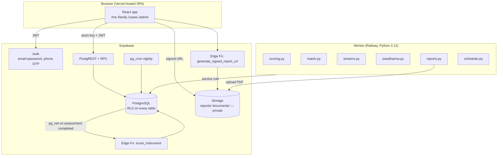
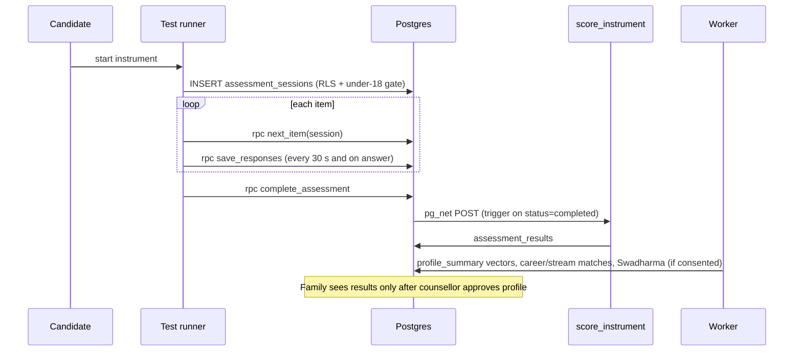
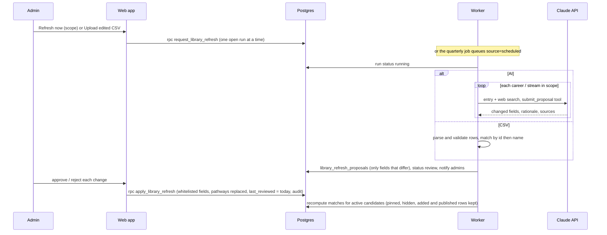
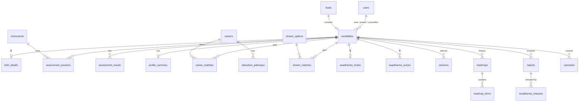

# SwadharmaPath — High-Level Design (HLD)

| Field | Value |
|---|---|
| Document | HLD |
| Version | 1.3 |
| Last updated | 2026-10-24 |
| Code baseline | `feat/start-here`: database, Edge Functions, web app (Start Here routes) and worker. |
| Related | [BRD](../brd/BRD.md) · [LLD](LLD.md) |

> Update this document in the same pull request as any change to components, integrations, deployment, data flow or the security model.

---

## 1. Architecture overview

SwadharmaPath has three runtime parts around one Supabase project:

1. **Web app** — React + TypeScript (Vite), shadcn/ui, Tailwind, Recharts. Reads and writes through Supabase with the user's JWT. It **only displays** scores; it never computes them.
2. **Supabase** — PostgreSQL with row-level security (RLS) as the security boundary, Supabase Auth, private Storage buckets, Edge Functions, `pg_net` and `pg_cron`.
3. **Worker** — a Python 3.12 package in `/worker` (pandas, numpy, pyswisseph, WeasyPrint, supabase-py, APScheduler) running on Railway with the service-role key. It does all scoring, matching, Swadharma computation, PDF reports and scheduled jobs.



## 2. Design principles

| Principle | How it shows up |
|---|---|
| The database is the security boundary | Every table has RLS. Visibility rules (Swadharma, approval gates, private notes, under-18) are enforced in SQL policies, views, triggers and column grants — the UI is not trusted. |
| Compute away from the client | Scoring keys, norms and items never reach the browser in bulk. The runner fetches one item at a time via `next_item()`. All scoring runs in the worker (mirrored in the Edge Function for instant feedback). |
| Counsellor in the loop | Results, profile, options and roadmap are drafts until a counsellor approves or publishes. |
| Append-only where trust matters | `swadharma_releases` and `audit_log` deny UPDATE/DELETE/TRUNCATE for every role; reports are write-once and versioned. |
| Track-aware UX | `early_explorer` gets junior instruments, stream recommendations, larger type and friendlier copy. |

## 3. Components

### 3.1 Web app (*implemented: `/cases`, `/cases/:id`, `/me`, `/me/assess`, `/admin/careers`, `/admin/streams`, `/admin/library/runs/:id`, `/admin/archive`; other routes show a placeholder*)

| Area | Routes | Notes |
|---|---|---|
| Public | `/`, `/enquire`, `/login`, `/about`, `/privacy` | Lead form inserts with the anon key |
| Candidate | `/me`, `/me/onboard`, `/me/assess`, `/me/assess/:instrument`, `/me/profile`, `/me/options`, `/me/options/:career`, `/me/streams`, `/me/roadmap`, `/me/sessions`, `/me/reports` | Stepper differs by track |
| Parent | `/family` | Read-only views of linked children |
| Counsellor | `/cases`, `/cases/:id` (9 tabs), `/schedule`, `/reports/queue` | Swadharma 🔒 tab |
| Admin | `/admin`, `/admin/leads`, `/admin/counsellors`, `/admin/careers`, `/admin/streams`, `/admin/library/runs/:id`, `/admin/instruments`, `/admin/templates`, `/admin/archive` | Library refresh (AI or CSV) with per-change review; archive with admin-set timeframe |

Route guard: everything except the public routes needs a session; after login the user is sent to the home for `users.role` (`/me`, `/family`, `/cases`, `/admin`). Supabase client: `src/lib/supabase.ts`, configured from `VITE_SUPABASE_URL` and `VITE_SUPABASE_ANON_KEY`. All data access goes through one `Api` interface with a Supabase implementation and an in-memory demo implementation; demo mode (`VITE_DEMO_MODE=true`, or no Supabase variables) lets reviewers click through every role without a backend.

### 3.2 Supabase database (*implemented in `supabase/migrations/001_init.sql` and `002_library_refresh_archive.sql`*)

- 27 tables (23 from the spec plus `notifications`, `library_refresh_runs`, `library_refresh_proposals`, `archive_settings`), all with RLS.
- `private` schema of `SECURITY DEFINER` helper functions used by policies so they never recurse.
- Candidate-facing views that strip sensitive fields: `v_candidate_matches`, `v_candidate_stream_matches`, `v_candidate_sessions`.
- Admin/caseload views running with invoker rights: `v_funnel`, `v_counsellor_utilisation`, `v_tat`, `v_outcomes`, `v_caseload`.
- Candidate RPCs: `my_instruments`, `next_item`, `save_responses`, `complete_assessment`, `accept_disclaimer`, `give_guardian_consent`, `submit_birth_details`.
- Admin RPCs: library refresh (`request_library_refresh`, `cancel_library_refresh`, `decide_refresh_proposal`, `apply_library_refresh`) and archiving (`archive_preview`, `archive_inactive`, `restore_archived`, `save_archive_settings`).
- Triggers for signup, role guard, lead rate limit, under-18 gate, scoring call, roadmap guard, report immutability and versioning, Swadharma release and append-only tables.
- Seed data: 20 careers with pathways, 8 CBSE stream options, junior and standard instrument versions with placeholder items.

### 3.3 Edge Functions (*implemented*)

| Function | Trigger | Responsibility |
|---|---|---|
| `score_instrument` | `pg_net` call from the `assessment_completed` trigger | Fast scoring of the completed session (mirror of `worker/scoring.py`, same fixtures) and write to `assessment_results`. The worker picks the new result up on its next poll for profile and matching |
| `generate_signed_report_url` | Called by the web app | Checks the caller may read the report (through RLS), then returns a 15-minute signed URL from the private `reports` bucket |

### 3.4 Worker (*implemented*)

| Module | Responsibility |
|---|---|
| `scoring.py` | Interest, aptitude, work-style, Big Five, values; validity flags |
| `match.py` | Career fit for student/professional; top 15 into `career_matches` |
| `streams.py` | Stream fit for early_explorer into `stream_matches` |
| `swadharma.py` | Swiss Ephemeris (Lahiri) charts and family points into `swadharma_charts`/`swadharma_scores` |
| `karakatwa.json` | Editable planet → career-family map |
| `reports.py` | WeasyPrint PDFs for six report kinds into `reports/` bucket |
| `library_refresh.py` | Turns a queued library refresh into proposals: Claude with web search (one call per career or stream) or a parsed admin CSV. Never writes the library itself |
| `scheduler.py` | APScheduler: minute polling (score fallback, refresh profile/matches/Swadharma, render reports, deliver notifications); library refresh and post-apply rematch; nightly SLA check and outcome reminders; quarterly library refresh (or reminder). Skips archived candidates |
| `db.py` | Service-role client from `SUPABASE_URL` and `SUPABASE_SERVICE_ROLE_KEY` |

## 4. Key flows

### 4.1 Enquiry to candidate

```mermaid
sequenceDiagram
  participant V as Visitor
  participant UI as Web app
  participant DB as Postgres
  participant A as Admin
  V->>UI: /enquire form
  UI->>DB: INSERT leads (anon)
  DB->>DB: leads_rate_limit trigger (validate, throttle, stage=new)
  A->>DB: assign counsellor, set next_followup, move stage
  A->>DB: create candidate (lead_id, counsellor_id); converted_candidate set
```

### 4.2 Assessment and scoring



### 4.3 Curation, publish and release

1. Worker writes `career_matches` / `stream_matches` with `visible_to_candidate = false`.
2. Counsellor pins/hides/adds, then publishes. Candidates read only through `v_candidate_*` views, which drop `breakdown.swadharma` and hidden rows.
3. Counsellor generates reports (worker renders the PDF, fills `pdf_path` once).
4. For Swadharma: counsellor inserts a `swadharma_releases` row (target + reason). A trigger validates consent, widens `reports.visible_to` for that report and writes `audit_log`. The release cannot be undone.

### 4.4 Library refresh



### 4.5 Archiving

1. The admin sets the inactivity timeframe (`archive_settings`) and either archives now (preview, then `archive_inactive` with cutoff dates) or turns on nightly auto-archive (`pg_cron` → `private.run_auto_archive()`, 02:30 IST).
2. Last activity is the latest of sign-up, assessment start or finish, session, roadmap item completion or publish, report and outcome. Candidates with a booked session and paid or active leads are never picked.
3. Archiving sets `archived_at`; nothing is deleted. Archived candidates drop out of `v_caseload` (so SLA reminders too), worker refresh and outcome reminders, and cannot start assessments. `restore_archived` clears the flag.

### 4.6 Nightly jobs

| Job | Where | Time |
|---|---|---|
| Mark overdue roadmap items `missed` and create notification rows | `pg_cron` → `private.mark_missed_roadmap_items()` | 02:00 IST (20:30 UTC) |
| Report SLA check, outcome checkpoint reminders (6/12/24 m) | Worker `scheduler.py` | 02:15 IST |
| Auto-archive with the admin's timeframe (only when turned on) | `pg_cron` → `private.run_auto_archive()` | 02:30 IST (21:00 UTC) |
| Quarterly library refresh (AI, needs `ANTHROPIC_API_KEY`), or a reminder to admins if there is no key or a refresh is open | Worker `scheduler.py` | 1 Jan/Apr/Jul/Oct, 09:00 IST |
| Scoring fallback, profile/match/Swadharma refresh, report rendering, notification delivery, library refresh processing and post-apply rematch | Worker `scheduler.py` | Every minute |

## 5. Security architecture

| Concern | Control |
|---|---|
| Authentication | Supabase Auth (email/password, phone OTP). New auth users get a `public.users` row by trigger; self-signup role is limited to candidate or parent. |
| Authorisation | RLS on every table using `private.*` helpers: `is_admin`, `is_staff`, `can_manage` (assigned counsellor or admin), `is_family` (candidate or linked parent). |
| Role escalation | `guard_users` trigger: only admin or service role may change `users.role`. |
| Swadharma isolation | `birth_details`, `swadharma_charts`, `swadharma_scores` have **no** candidate/parent policy. Birth details are written through `submit_birth_details()` which never returns the row. |
| Test content | Column grants hide `instruments.items`, `scoring_spec`, `norms`; `next_item()` strips scoring keys. |
| Private notes | Family reads sessions only via `v_candidate_sessions`, which omits `notes_private`. |
| Reports | Private bucket with no client policy; 15-minute signed URLs. Write-once, versioned. |
| Append-only | Triggers and revoked privileges on `swadharma_releases`, `audit_log`; delete denied on `reports`. |
| Minors | `assessment_gate` trigger and RLS check guardian consent; unknown DOB fails closed. |
| Abuse | Lead form throttled per contact (3/hour) and globally (30/minute). |
| Library integrity | AI and CSV output is stored as proposals; only `apply_library_refresh` (admin) writes the library, and only whitelisted fields. The worker sends Claude library content only, never candidate data. |
| Archiving | Admin-only RPCs; no delete anywhere; audited. Archived rows keep every existing policy, so Swadharma isolation and append-only rules are unchanged. |
| Secrets | Service-role key only in the worker and Edge Function environment and Supabase Vault (`project_url`, `service_role_key`). `ANTHROPIC_API_KEY` only on the worker. Never in `VITE_*` variables. |

## 6. Deployment view

| Component | Platform | Config |
|---|---|---|
| Web | Vercel project `swadharmapath` (team YSS), production branch `main`; `vercel.json` rewrites client routes to `index.html` and sets basic security headers | `VITE_SUPABASE_URL`, `VITE_SUPABASE_ANON_KEY` |
| Database, Auth, Storage, Edge Functions | Supabase project `SwadharmaPath` (ref `fskmeqrjtwdswaoqwjkh`, ap-south-1) | Migrations in `supabase/migrations`; Vault secrets `project_url`, `service_role_key`; extensions `pgcrypto`, `pg_net`, `pg_cron` |
| Worker | Railway (`worker/Dockerfile`, `worker/railway.json`; one instance) | `SUPABASE_URL`, `SUPABASE_SERVICE_ROLE_KEY`, `ANTHROPIC_API_KEY` (for AI library refresh; optional) |
| Claude API | Anthropic (`claude-opus-5-5` with web search) | Called by the worker only, about ₹15–20 per library entry, roughly ₹500 for a full refresh of the seeded library |

Environments: local (Supabase CLI or plain Postgres for SQL tests) → staging Supabase project → production. See [Release and deployment SOP](../sops/technical-sops.md#sop-t1-release-and-deployment).

## 7. Data overview

Core entities and ownership (full column list in the [LLD](LLD.md#3-data-model)):



## 8. Quality attributes and testing

- **SQL tests** (`supabase/tests/run.sh`) build a throwaway database, apply every migration in order and run RLS tests as each role, plus owner-level tests (including library refresh and archiving). Run them on every database change.
- Frontend: Vitest (runner helpers and the TS scorer), `tsc -b`, `vite build`; Playwright click-through in demo mode during development.
- Edge Functions: `deno check`; the TS scorer and the Python scorer pass the same fixture file.
- Worker: `pytest` per engine rule (SAV 337 checksum, divisional charts, KP sub-lords, banned lens words, no Swadharma in family reports) plus an end-to-end run on an in-memory database.
- Docs check: CI fails a pull request that changes code without updating `/docs` ([CONTRIBUTING](../../CONTRIBUTING.md)).

## 9. Open items

| Item | Owner |
|---|---|
| Notification delivery channel (email/SMS/WhatsApp) | Business decision |
| Validated instrument items and norms | Agency |
| Report templates and branding assets | Agency |
| Candidate onboarding writes: the current migration has no candidate UPDATE policy on `candidates` and no onboarding RPC, so `/me/onboard` profile/academics/constraints/DOB need an RPC (or policy) | Build |
| Parent "message to counsellor" on `/family` has no table or RPC yet | Build |
| Re-administer flow (invalidate session, start new) has no dedicated RPC yet; counsellors can do it through `asess_staff` policy | Build |

## 10. Change history

| Version | Date | Change |
|---|---|---|
| 1.0 | 2026-10-24 | Baseline from spec and `feat/start-here` database migration |
| 1.1 | 2026-10-24 | Edge Functions, web app (Start Here routes, demo mode) and worker implemented; worker variables, schedule and deployment confirmed |
| 1.2 | 2026-10-24 | Production go-live: Supabase project created and seeded, Edge Functions deployed, Vercel project linked to the repo with `vercel.json` for SPA routing and headers |
| 1.3 | 2026-10-24 | Library refresh (AI via Claude API or CSV, admin approval, rematch) and archiving (admin timeframe, nightly auto-archive, restore): components, flows 4.4–4.5, jobs, security, deployment (`ANTHROPIC_API_KEY`) |
