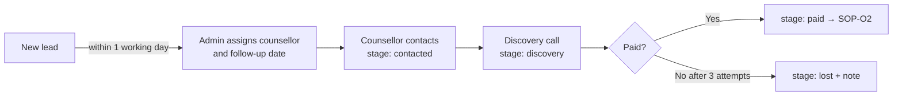
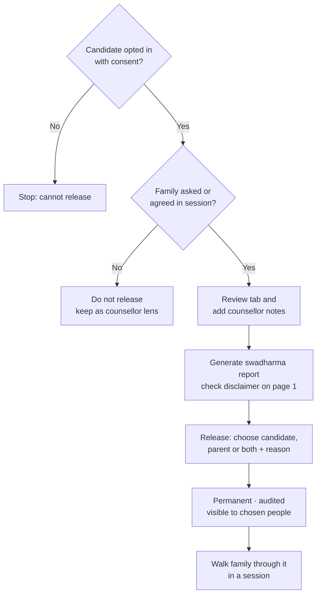
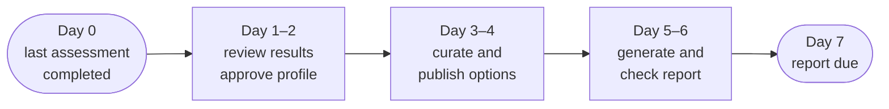

# Operations SOPs

Standard operating procedures for counsellors and admins. Each SOP lists who does it, when, the steps and the record that proves it was done.

> Last updated 2026-10-24. Change an SOP in the same pull request as the feature it describes.

| ID | SOP | Owner |
|---|---|---|
| O1 | [Lead intake and follow-up](#sop-o1-lead-intake-and-follow-up) | Admin, counsellor |
| O2 | [Converting a lead to a candidate](#sop-o2-converting-a-lead-to-a-candidate) | Admin |
| O3 | [Onboarding and consent](#sop-o3-onboarding-and-consent) | Counsellor |
| O4 | [Assessment administration and re-administration](#sop-o4-assessment-administration-and-re-administration) | Counsellor |
| O5 | [Profile review, curation and publishing](#sop-o5-profile-review-curation-and-publishing) | Counsellor |
| O6 | [Releasing a Swadharma report](#sop-o6-releasing-a-swadharma-report) | Counsellor |
| O7 | [Sessions](#sop-o7-sessions) | Counsellor |
| O8 | [Reports and SLA](#sop-o8-reports-and-sla) | Counsellor, admin |
| O9 | [Instrument version change](#sop-o9-instrument-version-change) | Admin |
| O10 | [Career library and outlook refresh](#sop-o10-career-library-and-outlook-refresh) | Admin |
| O11 | [Roadmap and missed items](#sop-o11-roadmap-and-missed-items) | Counsellor |
| O12 | [Outcome follow-up](#sop-o12-outcome-follow-up) | Counsellor |
| O13 | [Staff onboarding and offboarding](#sop-o13-staff-onboarding-and-offboarding) | Admin |
| O14 | [Privacy requests and data incidents](#sop-o14-privacy-requests-and-data-incidents) | Admin |

---

## SOP-O1 Lead intake and follow-up

**Trigger:** a new lead appears (web form, WhatsApp, referral, school, walk-in).

1. Within 1 working day, admin opens **/admin/leads**, assigns a counsellor and sets **next follow-up**.
2. Leads from non-web sources are entered by staff with the correct **source**.
3. The counsellor contacts the lead and moves the stage to **contacted**, then **discovery** after the discovery call.
4. When payment is confirmed, move to **paid** (manual revenue flag in V1).
5. If the lead declines or is unreachable after 3 attempts, move to **lost** with a note.

**Record:** lead stage, assigned counsellor, next follow-up date, notes.

## SOP-O2 Converting a lead to a candidate

1. Confirm stage is **paid**.
2. Create or invite the candidate user (email or phone).
3. Create the candidate record with track, linked lead and assigned counsellor. Set the lead's converted candidate and stage **active**.
4. If the candidate is under 18 (or DOB unknown), invite the parent and link them as the candidate's parent.
5. Send login instructions.

**Record:** `candidates.lead_id`, `leads.converted_candidate`, `candidates.parent_user_id`.

## SOP-O3 Onboarding and consent

1. Ask the candidate to complete **/me/onboard**, including the disclaimer.
2. For under-18s, check the guardian has pressed **Give consent**. Until then the candidate cannot start assessments (the database blocks it).
3. Swadharma is optional. Mention it neutrally; do not push it. If the family opts in, they tick the versioned consent and submit birth details.
4. Check on the case **Overview** that disclaimer, guardian consent and (if any) Swadharma consent show as recorded.

**Record:** `disclaimer_accepted_at`, `guardian_consent_at`, `birth_details.consent_at` and `consent_text_version`, audit entries.

## SOP-O4 Assessment administration and re-administration

1. Tell the candidate the estimated time and that timed sections cannot be paused or revisited.
2. Monitor **/cases/:id → Assessments** for completion.
3. Within 1 working day of completion, check validity flags.
4. If a result is invalid (for example straight-lining), discuss with the candidate, then press **Re-administer**. The old session is invalidated; a new session starts fresh.

**Record:** session status, validity flags, invalidated session.

## SOP-O5 Profile review, curation and publishing

1. Review results and validity flags.
2. Edit the narrative: strengths, watch-outs, themes in plain language. For early explorers, use "leanings".
3. **Approve** the profile. Only then can the family see results.
4. Open **Options**. Pin strong fits, hide unsuitable ones (with a reason in your notes), add any missing career or stream.
5. Early explorer: make sure the widest "keep options open" stream is present and no single career is presented as the answer.
6. Switch **Publish to candidate** on.

**Record:** `profile_summary.approved_by/approved_at`, `counsellor_action`, `visible_to_candidate`.

## SOP-O6 Releasing a Swadharma report

Only if the candidate (and guardian for minors) opted in, and the family has asked for it or agreed in a session.

1. Review the Swadharma tab: confidence, agreement matrix, favourable windows. Add counsellor notes.
2. Generate a **swadharma** report and check page 1 has the full disclaimer.
3. Press **Release Swadharma Report**, choose candidate, parent or both, and write a clear reason (for example "Discussed in session 3; family requested the report").
4. Confirm. The release is permanent and logged. It cannot be withdrawn.
5. Walk the family through the report in a session; reinforce that it is a reflection lens only.

**Never:** release without consent, release a case file to a family, or use Swadharma to rule out a career.

**Record:** `swadharma_releases` row, `audit_log` entry `swadharma_release`, report `visible_to`.

**If released to the wrong person:** it cannot be reversed in the system. Inform the admin immediately and follow [SOP-O14](#sop-o14-privacy-requests-and-data-incidents).

## SOP-O7 Sessions

1. Schedule in **Sessions** with mode and meeting URL. The family sees it on /me/sessions and /family.
2. After the session, within 24 hours, fill the ICCC-stage template: private notes, **Summary for candidate**, action items, attended.
3. Add any action items to the roadmap.

**Record:** `sessions` row with `iccc_stage`, `attended`, summary.

## SOP-O8 Reports and SLA

1. The report SLA is **7 days** from the last completed assessment.
2. Check **/reports/queue** daily. Work the oldest due first.
3. Generate the right kind: candidate (student/professional), candidate_junior and stream_choice (early explorer), parent, case_file (internal).
4. Check the PDF: name, track, disclaimer present, no Swadharma content in non-Swadharma family reports.
5. To correct a report, generate again; a new version is created. Old versions stay.
6. Admin reviews SLA breaches weekly on **/admin/counsellors**.

**Record:** `reports` versions, `v_tat`.

## SOP-O9 Instrument version change

1. Prepare the new version (items, scoring spec, norms) outside production and test it in staging.
2. In **/admin/instruments**, upload the new version and norms.
3. Activate the new version and deactivate the old one at a quiet time. Candidates mid-test keep their existing session.
4. Update the instrument section of the [LLD](../design/LLD.md#91-scoring-workerscoringpy-mirrored-in-score_instrument) if scoring rules change.

**Record:** `instruments.version`, `is_active`, change note in the PR.

## SOP-O10 Career library and outlook refresh

**Trigger:** quarterly reminder, or new evidence.

1. For each career due for review, check outlook, automation exposure, salary band and exams against current sources.
2. Update the fields, add the **source** and set **last reviewed** to today.
3. Replace any content still marked "seed – verify before launch".

**Record:** `careers.sources`, `careers.last_reviewed`.

## SOP-O11 Roadmap and missed items

1. Build from a template, adjust items, owners and due dates, then **Publish**.
2. Each morning, review notifications for items marked **Missed** overnight.
3. Contact the owner, agree a new date, update the item.

## SOP-O12 Outcome follow-up

1. At 6, 12 and 24 months after roadmap publish, the scheduler reminds you.
2. Contact the candidate; record status, current career, whether it was in the top 5, and satisfaction 1–5.

**Record:** `outcomes` row per checkpoint.

## SOP-O13 Staff onboarding and offboarding

**Onboarding:** invite the user, set role to counsellor (admin only), walk them through the [Counsellor guide](../user-guides/counsellor.md) and these SOPs, assign a small caseload first.

**Offboarding:** reassign all their candidates and open leads, then change the role to a non-staff role or disable the auth user. Do not delete the user; audit history references them.

## SOP-O14 Privacy requests and data incidents

**Access or correction request:** verify identity, then export or correct the data within 30 days. Birth details may be corrected only through a new consent submission.

**Deletion request:** admin coordinates with the technical owner; audit log and Swadharma releases are retained as a legal record of consent.

**Incident (data shown to the wrong person, leaked link, wrong release):**
1. Admin records the incident with time, people affected and data involved.
2. Contain: revoke sessions, rotate keys if needed (see [SOP-T5](technical-sops.md#sop-t5-secret-rotation)).
3. Inform affected families and, where required by the DPDP Act, the authorities.
4. Write a short post-incident note and update docs or controls.
