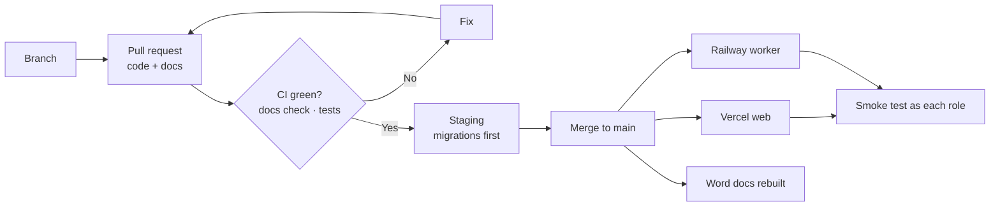
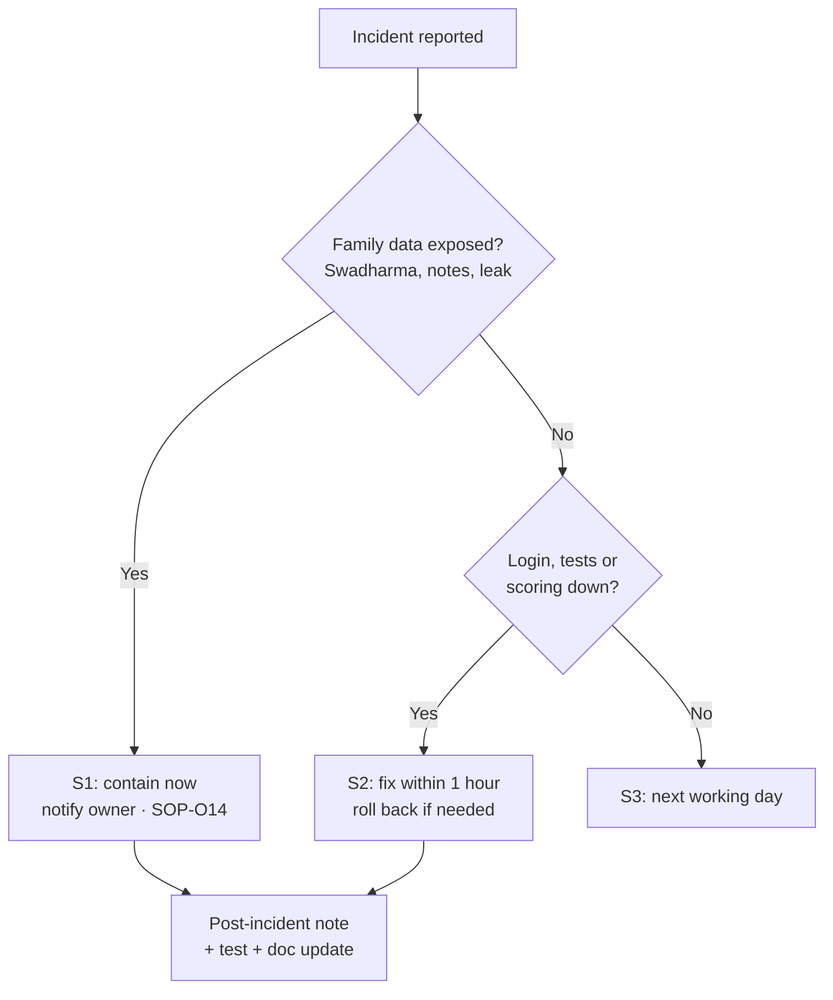
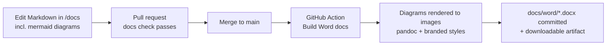

# Technical SOPs

Procedures for developers and the technical owner.

> Last updated 2026-10-24.

| ID | SOP |
|---|---|
| T1 | [Release and deployment](#sop-t1-release-and-deployment) |
| T2 | [Database migration](#sop-t2-database-migration) |
| T3 | [Regenerating seed data](#sop-t3-regenerating-seed-data) |
| T4 | [Worker operations](#sop-t4-worker-operations) |
| T5 | [Secret rotation](#sop-t5-secret-rotation) |
| T6 | [Backup and restore](#sop-t6-backup-and-restore) |
| T7 | [Incident response](#sop-t7-incident-response) |
| T8 | [Documentation maintenance](#sop-t8-documentation-maintenance) |
| T9 | [Word (.docx) versions of the docs](#sop-t9-word-docx-versions-of-the-docs) |

---

## SOP-T1 Release and deployment



1. Every change goes through a pull request to `main`.
2. CI must be green, including the **docs check** (code changes need matching `/docs` changes).
3. Database changes: run `supabase/tests/run.sh` locally; apply to staging first ([SOP-T2](#sop-t2-database-migration)).
4. Merge. Vercel deploys the web app from `main`. Railway deploys the worker from `main`.
5. Smoke test production: login as each role with test accounts, open /me, /family, /cases, /admin; submit a test enquiry.
6. Note the release in the change history of any doc you changed.

**Rollback:** web — redeploy the previous Vercel deployment; worker — redeploy the previous Railway release; database — write a forward-fixing migration (never edit an applied migration).

## SOP-T2 Database migration

1. Add a new file `supabase/migrations/NNN_description.sql`. Do not edit an applied migration.
2. Every new table: enable RLS and add policies. Sensitive tables get **no** candidate/parent policy.
3. Add tests in `supabase/tests/rls_test.sql` or `owner_test.sql`.
4. Run locally:
   ```bash
   PGHOST=localhost PGUSER=postgres ./supabase/tests/run.sh
   ```
5. Apply to staging (`supabase db push` against the staging project), run smoke tests, then production.
6. Update the [LLD](../design/LLD.md) data model, access matrix, triggers and RPCs sections.

## SOP-T3 Regenerating seed data

1. Edit `supabase/seed/library.py` (careers, streams) or `supabase/seed/instruments.py`.
2. Run `python3 supabase/seed/build_seed.py`. It rewrites everything after `-- BEGIN GENERATED SEED` in the migration.
3. Run the SQL tests. Commit the generated SQL with the source change.

## SOP-T4 Worker operations

1. Railway service runs Python 3.12 with the service-role key.
2. Check logs after deploy for scheduler start and a successful database connection.
3. If scoring or reports stop: check Railway logs, then Supabase logs for `score_instrument`, then the Vault secrets used by `invoke_edge_function`.
4. Re-run scoring for a session by re-triggering the worker job for that session (command to be documented when the worker lands).

## SOP-T5 Secret rotation

1. Rotate the service-role key in Supabase.
2. Update it in Railway (worker), Edge Function secrets and Vault `service_role_key`.
3. Rotate the anon key only if exposed; update `VITE_SUPABASE_ANON_KEY` in Vercel and redeploy.
4. Verify scoring (complete a test assessment) and report download.

Never put the service-role key in a `VITE_*` variable or in the repo.

## SOP-T6 Backup and restore

1. Supabase daily backups (and point-in-time recovery if enabled on the plan).
2. Storage buckets `reports` and `documents`: periodic export.
3. Test a restore to a scratch project quarterly.

## SOP-T7 Incident response



| Severity | Example | Response |
|---|---|---|
| S1 | Swadharma or private notes visible to a family; data leak | Immediately: disable affected route or policy, notify owner, follow [SOP-O14](operations-sops.md#sop-o14-privacy-requests-and-data-incidents) |
| S2 | Logins, test runner or scoring down | Within 1 hour: diagnose via Vercel, Supabase and Railway logs; roll back if a recent deploy caused it |
| S3 | A dashboard number wrong, a report layout issue | Next working day |

After any S1/S2: short post-incident note, a test that would have caught it, and doc updates.

## SOP-T8 Documentation maintenance

**Rule:** every code or spec change updates the matching docs in the same branch and pull request.

1. Check [the doc map](../README.md#which-doc-to-update) to find which docs your change touches.
2. Update them, and add a line to the doc's change history when behaviour changes.
3. Tick the docs box in the PR template.
4. CI runs `scripts/check_docs.py`. It fails when code changes have no `/docs` change, or when a mapped area (for example `supabase/migrations/`) changes without its mapped doc.
5. For a change with genuinely no doc impact (formatting, dependency bump), add the label `docs-not-required` and say why in the PR description. Reviewers must agree.

## SOP-T9 Word (.docx) versions of the docs

The Markdown files in `/docs` are the master copy. Branded Word versions live in `docs/word/` and are **generated, never edited by hand**.



1. Edit the Markdown. Draw diagrams as ```` ```mermaid ```` blocks; they render on GitHub and become images in Word. Prefer `flowchart LR` with `direction TB` subgraphs so diagrams stay readable on an A4 page, and avoid `;` inside labels.
2. After merge to `main`, the **Build Word docs** workflow (`.github/workflows/docs-word.yml`) runs `scripts/docx/build_docx.py` and commits the updated `.docx` files. It can also be run by hand from the Actions tab (*Run workflow*).
3. To build locally (needs pandoc, Node 22, python-docx):
   ```bash
   npm ci --prefix scripts/docx
   npx --prefix scripts/docx playwright install chromium
   python3 scripts/docx/build_docx.py                     # all documents
   python3 scripts/docx/build_docx.py SwadharmaPath-BRD   # one document
   ```
4. To add a new document, add a row to `DOCS_TO_BUILD` in `scripts/docx/build_docx.py` and to the table in `docs/README.md`.

Each Word file has a cover page, a clickable contents list, page headers and numbers, teal header rows on tables and all diagrams as images.

