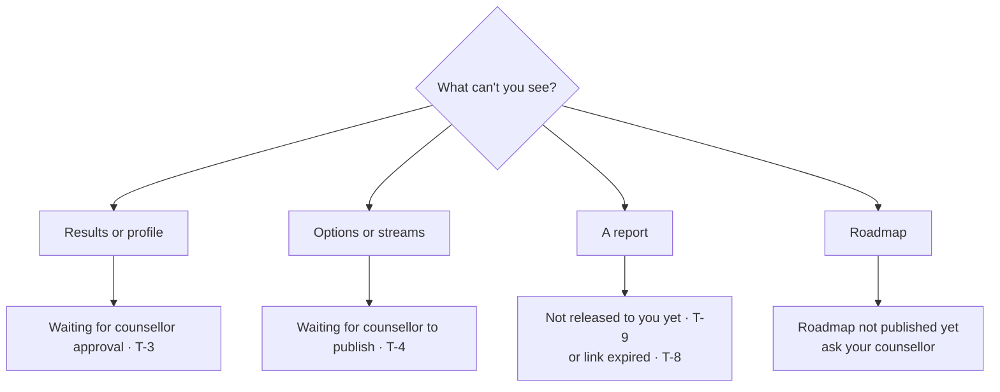

# Self-help troubleshooting

Find your problem, try the fix, and contact your counsellor (families) or the technical owner (staff) if it persists.

> Last updated 2026-10-24. Add an entry here whenever a fix changes user-visible behaviour or error messages.

## For candidates and parents

### T-1 I cannot log in
- **Email login:** check spelling; use "Forgot password" to reset.
- **Phone OTP:** enter the number with country code (+91). Codes expire after a few minutes; request a new one. Check SMS is not blocked.
- **No account yet:** accounts are created by the agency after enquiry. Contact them.

### T-2 "Guardian consent is required before an under-18 candidate can start an assessment"
Your parent or guardian must open **/family** and press **Give consent**. If your date of birth is missing, add it in onboarding; until then you are treated as under 18. If no parent is linked, ask your counsellor to link one.

### T-3 I cannot see my results / profile
Results show only after your counsellor approves your profile. This usually happens after your assessments are reviewed. Check with your counsellor.

### T-4 I cannot see options or streams
Your counsellor publishes them after review. Until then the page is empty.

### T-5 My test reset, skipped ahead or will not let me go back
- Answers save every 30 seconds; if you closed the browser, press **Resume** to continue at your first unanswered question.
- In **timed** sections the clock keeps running when you leave, and you cannot go back ("back navigation is not allowed in a timed section"). If time ran out, you are moved to the next section. This is by design.
- An answer given more than 30 seconds after a timed section ended is not saved.

### T-6 Assessment completed but no results
Scoring runs automatically but your counsellor still has to review it. If several days pass, ask your counsellor. (Staff: see T-21.)

### T-7 "Assessment is not in progress"
The test was already completed or your counsellor invalidated it. Reload **/me/assess**; if a new attempt is needed your counsellor will re-administer it.

### T-8 Report download link does not work
Links expire after 15 minutes. Go back to **/me/reports** (or **/family**) and press Download again.

### T-9 I don't see a report my counsellor mentioned
Only released reports appear. Ask your counsellor to check it was released to you (candidate) or to you as parent.

### T-10 I submitted birth details but cannot see them
This is intentional. Birth details are visible only to your counsellor and the admin. To correct them, submit again; the latest submission replaces the earlier one.

### T-11 I cannot mark a roadmap item as Missed or change its title
You can change only the status (to do, in progress, done) and add evidence. Missed is set automatically overnight. Ask your counsellor to change dates or titles.

### T-12 The enquiry form says "too many enquiries" or "busy"
The same phone or email can submit 3 times an hour, and the form accepts 30 enquiries a minute in total. Wait and try later, or contact the agency directly.

### T-13 "Invalid enquiry"
Name must be 1–120 characters, notes up to 2000 characters, and you must give a phone number or an email.

## For counsellors

### T-20 A candidate is missing from my caseload
You see only candidates where you are the assigned counsellor. Ask an admin to check the assignment.

### T-21 Results did not appear after a candidate completed a test
1. Check **Assessments**: status should be completed.
2. If completed but not scored for more than 15 minutes, report it to the technical owner with the candidate name and instrument. (Technical: check `score_instrument` logs and the Vault secrets `project_url` and `service_role_key`; a missing secret logs a warning and skips the call.)

### T-22 "Only counsellor_notes can be edited"
Swadharma points come from the engine; you can only edit the notes field.

### T-23 "A release must reference this candidate's swadharma report"
Generate a **swadharma** kind report for this candidate first, then release that report.

### T-24 "Candidate has not consented to the Swadharma analysis"
The candidate (or guardian) has not opted in with birth details and consent. You cannot release without it.

### T-25 "Reports are immutable; generate a new version instead"
Reports cannot be edited. Generate again to create a new version.

### T-26 Family cannot see a case file
Case files are counsellor-only by design. Generate a candidate, candidate_junior, parent or stream_choice report for families.

### T-27 Swadharma tab is empty
The candidate did not opt in, or the engine has not run yet. If birth time is unknown, expect fewer components and confidence "low".

## For admins

### T-30 "Only an admin can change a role"
Role changes require an admin account. Self-signed-up users are always candidate or parent until an admin changes them.

### T-31 Dashboard numbers look wrong
Funnel counts depend on lead stages being kept current; turnaround counts from the last completed assessment to the first candidate-facing report. Check stages and report kinds before raising a bug.

### T-32 Instrument not showing for candidates
Only active instruments matching the track variant are shown (early explorer → junior; others → standard). Check **is active** and the variant.

## For developers

### T-40 SQL tests fail to start
`run.sh` needs a local Postgres 15+ and the `authenticator` role created by `supabase_stub.sql`. Run with `PGHOST=localhost PGUSER=postgres`.

### T-41 `pg_net` / `pg_cron` not available notice
Expected on plain Postgres; the migration skips them. On Supabase, enable both extensions.

### T-42 CI "docs check" failed
Your PR changes code without changing `/docs`, or changes a mapped area without its mapped doc. Update the docs listed in the failure message. See [SOP-T8](../sops/technical-sops.md#sop-t8-documentation-maintenance).

### T-43 Word (.docx) files are out of date or the "Build Word docs" job failed
The Word files rebuild only after a merge to `main`. Open the Actions tab and check **Build Word docs**. A Mermaid syntax error names the diagram that failed; a `;` inside a label is the usual cause. Fix the Markdown and merge again, or run the workflow by hand. See [SOP-T9](../sops/technical-sops.md#sop-t9-word-docx-versions-of-the-docs).

## Error code reference

| Code | Meaning | Typical cause |
|---|---|---|
| 42501 | Not permitted | Role or ownership rule, missing consent, immutable record |
| 22023 | Invalid input or state | Bad form data, test not in progress, back navigation in timed section |
| P0429 | Rate limited | Too many enquiries |
