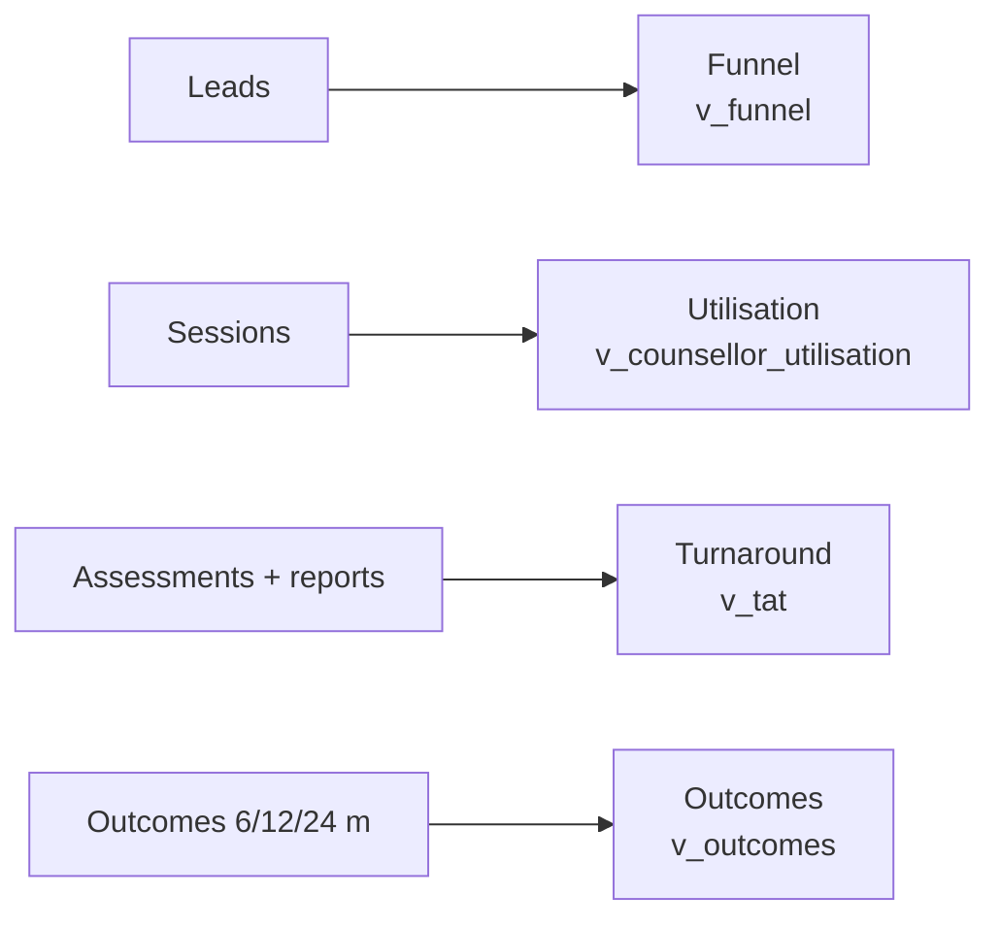
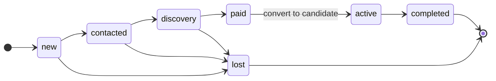

# Admin guide

For agency administrators. Your home page is **/admin**. Navigation: Dashboard | Leads | Counsellors | Careers | Instruments | Templates.

> Last updated 2026-10-24. Procedures are in the [Operations SOPs](../sops/operations-sops.md) and [Technical SOPs](../sops/technical-sops.md).

## 1. Dashboard (/admin)

| Widget | Source | Meaning |
|---|---|---|
| Funnel | `v_funnel` | Leads by stage and track, total and last 30 days |
| Revenue | lead stage `paid` | Manual paid flag in V1 |
| Counsellor utilisation | `v_counsellor_utilisation` | Active candidates, sessions and attended minutes in 30 days |
| Report turnaround | `v_tat` | Days from last completed assessment to first candidate-facing report; pending count |
| NPS | survey responses | Net promoter score |
| Outcomes | `v_outcomes` | Per 6/12/24-month checkpoint: count, % in top 5, average satisfaction |

## 2. Leads (/admin/leads)

Pipeline board with stages **new → contacted → discovery → paid → active → completed** (or **lost**).

1. Open a new lead and assign a counsellor.
2. Set the next follow-up date.
3. Move the card as the conversation progresses. Mark **paid** when payment is received (manual flag).
4. Convert to a candidate: create the candidate account, link the lead, assign the counsellor and, for minors, link the parent account.

The public form is rate-limited: the same phone or email can submit 3 times an hour, and the whole form accepts 30 enquiries a minute.

## 3. Users and roles

- People who sign up themselves can only be candidates or parents.
- To create a counsellor or admin, invite the user and then change their role. Only an admin can change a role, and the change is enforced in the database.

## 4. Counsellors (/admin/counsellors)
Caseload and report SLA per counsellor. Reassign candidates when someone is overloaded or on leave.

## 5. Career library (/admin/careers)
Edit careers (family, RIASEC code, weights, aptitude minimums, work-style and values fit, description, day in the life, entry paths, salary band, outlook, automation exposure, adjacent emerging roles) and education pathways. When refreshing outlook, record the **source** and set **last reviewed**. You get a quarterly reminder. Seed content is marked "seed – verify before launch" and must be reviewed.

## 6. Streams (/admin/streams)
Edit stream options per board: subjects, career families each keeps open and closes, notes. CBSE is seeded with 8 streams.

## 7. Instruments (/admin/instruments)
Manage versions, upload norms and **activate** an instrument version. Only active versions are served. Test items, scoring keys and norms are never sent to candidates' browsers. See [SOP-O9](../sops/operations-sops.md#sop-o9-instrument-version-change).

## 8. Templates (/admin/templates)
Roadmap templates and session-note templates (by ICCC stage).

## 9. Audit
Admins can read the audit log (consents, disclaimer acceptances, Swadharma releases). No one, including admins, can edit or delete audit entries or Swadharma releases.
