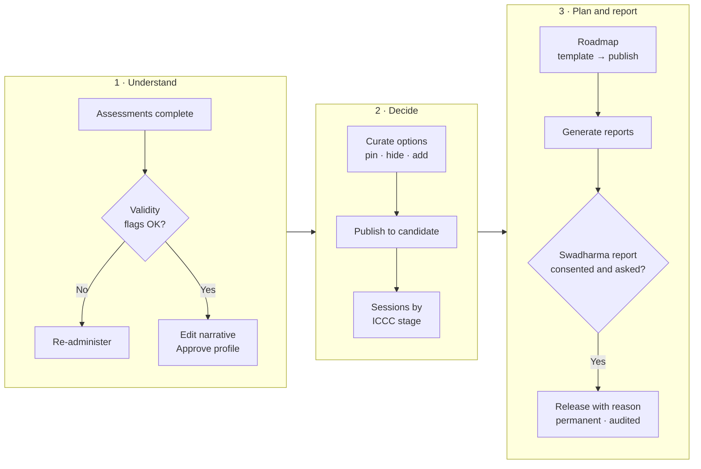

# Counsellor guide

For agency counsellors. Your home page is **/cases**. Navigation: Cases | Schedule | Reports | Library | Settings.

> Last updated 2026-10-24. Step-by-step procedures are in the [Operations SOPs](../sops/operations-sops.md).

## 1. Caseload (/cases)

The table lists every candidate assigned to you:

| Column | Meaning |
|---|---|
| Name, Track | early_explorer, student or professional |
| Stage | ICCC stage from the latest session: know_self, know_world, decide, plan, act, review (default know_self) |
| Risk flag | Raised by validity issues, missed roadmap items or pending guardian consent |
| Next action | Next session or the next step needed |
| Report SLA | Due 7 days after the last completed assessment |

You only see candidates where you are the assigned counsellor.

## 2. Case workspace (/cases/:id)

Tabs: **Overview | Assessments | Profile | Swadharma 🔒 | Options | Sessions | Roadmap | Reports | Documents**

### Overview
Key facts, consent status (disclaimer, guardian, Swadharma), progress and upcoming items.

### Assessments
- Status of each instrument and its validity flags: very fast answers (median < 1.5 s), straight-lining (10+ identical in a row), high social desirability, large self-vs-others gap.
- **Re-administer** an instrument when results are invalid: the old session is invalidated and the candidate gets a fresh one.

### Profile
Edit the plain-language narrative (strengths, watch-outs, themes) and **Approve**. Until you approve, the candidate and parent cannot see any results.

### Swadharma 🔒
Visible only to you and admins, and only if the candidate opted in with consent.
- Chart summary, the 15-family points table with component breakdown and confidence, personality lens, agreement matrix vs the psychometric top 5, favourable windows.
- **Counsellor notes** is the only field you can edit.
- **Release Swadharma Report**: choose candidate, parent or both and enter a reason. A release is **permanent and logged**; it cannot be undone. Generate the Swadharma report first. See [SOP-O6](../sops/operations-sops.md#sop-o6-releasing-a-swadharma-report).

Never use Swadharma to rule out a career, and never discuss health, marriage, longevity or wealth.

### Options
- Ranked careers (student/professional) or streams (early_explorer) from the matching engine.
- **Pin**, **Hide** or **Add** options, then switch **Publish to candidate** on. Hidden options never show to the family. Swadharma points are stripped from everything the family sees.
- For early explorers, keep the widest "keep options open" stream in the list and never present a single career.

### Sessions
Schedule (video, in person, phone) with a meeting URL. Use the ICCC-stage note template. **Private notes** are never visible to the family; write what they should see in **Summary for candidate** and add action items.

### Roadmap
Pick a template (class8_10_exposure, class11_12, ug, pg_prep, transition, custom), edit items (kind, owner, due date), then **Publish**. The family sees the roadmap only after it is published. Overdue items become Missed overnight and you are notified.

### Reports
Generate candidate, candidate_junior, parent, stream_choice, case_file or swadharma. Each generation creates a **new version**; reports cannot be edited or deleted. Case files and Swadharma reports stay counsellor-only (a Swadharma report reaches the family only through a release). Download through a signed link valid for 15 minutes.

### Documents
Files shared with the case, including roadmap evidence uploaded by the candidate.

## 3. Schedule (/schedule)
Calendar of all your sessions.

## 4. Report queue (/reports/queue)
Pending generations and SLA status. Work the oldest breach first.

## 5. Leads assigned to you
You can view all leads and update the ones assigned to you (stage, follow-up date, notes).

## 6. Do and don't

| Do | Don't |
|---|---|
| Approve the profile only after reviewing validity flags | Share results by WhatsApp or email outside the platform |
| Write family-facing text in Summary for candidate | Put anything sensitive in Summary for candidate |
| Record a clear reason for every Swadharma release | Release Swadharma to a family that did not consent or ask |
| Use "leanings" language with early explorers | Present a single career to an early explorer |
