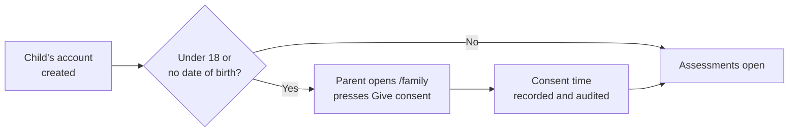
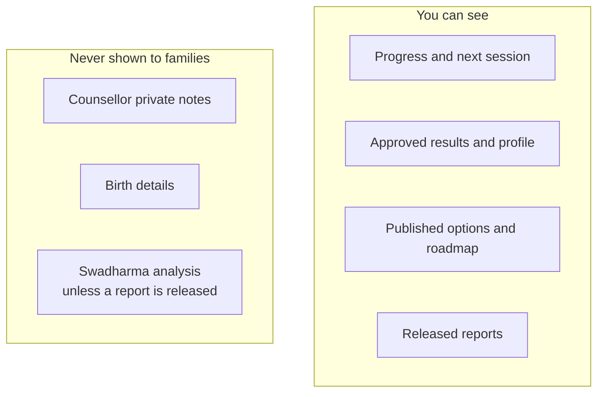

# Parent and guardian guide

For parents and guardians linked to a candidate. Your home page is **/family**.

> Last updated 2026-10-24. See also [Self-help troubleshooting](../troubleshooting/troubleshooting.md).

## 1. Signing in

Go to **/login** and use your email and password or your phone number and one-time code. The agency links your account to your child's profile.

## 2. Giving consent for a child under 18

Children under 18 cannot start any assessment until you give consent.

1. Open **/family** and select your child.
2. Read the consent notice and press **Give consent**.
3. The time of consent is recorded. Your child can now start the assessments.

If your child's date of birth is missing, the system treats them as under 18 and still asks for your consent.

## 3. Birth details and the Swadharma lens (optional)

You or your child may submit birth details for the Swadharma (Vedic astrology) lens after ticking the consent box. After submitting:

- You cannot view the details again; only the counsellor and admin can.
- The analysis is a reflection lens only. It is never used to rule out a career.
- You see a Swadharma Report only if the counsellor deliberately releases it to you. That release is logged.

## 4. What you can see on /family

| Section | What it shows |
|---|---|
| Linked children | Each child linked to your account |
| Progress | Percentage through the journey |
| Next session | Date, time and meeting link |
| Parent summary | The 2-page parent report once released |
| Roadmap | Your child's published plan (read-only) |
| Message counsellor | Send a note to the assigned counsellor |

You see results, options and reports only after the counsellor approves, publishes or releases them. Private session notes are never shown.

## 5. Roadmap items owned by parents

Some roadmap items may be assigned to you (for example "Visit two colleges"). You get a reminder if one becomes overdue. Ask the counsellor to update parent-owned items, or follow the instructions on the item.

## 6. Reports

Released reports appear for download. Each download link is valid for 15 minutes; open it again if it expires.

## 7. Disclaimer

"SwadharmaPath supports career decisions; it does not make them. Psychometric results describe tendencies at a point in time and are interpreted by a trained counsellor; they are not a measure of worth or a guarantee of success. The Swadharma (Vedic astrology) analysis is a traditional lens offered for reflection; it has no established scientific validity, is never used to rule out any career, and is shared only with your consent. Decisions remain yours and your family's."
